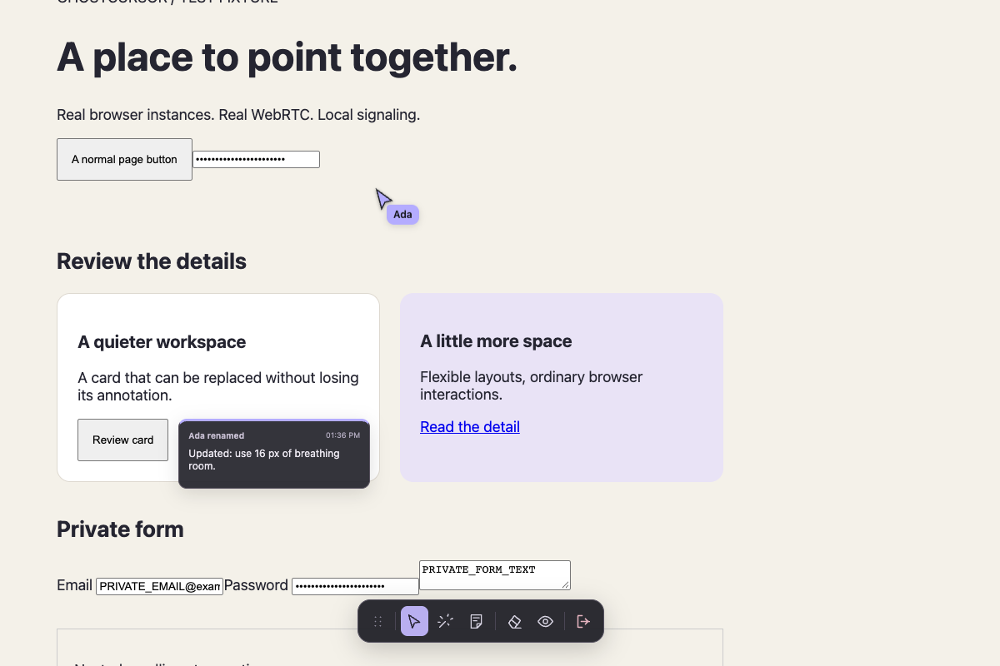

# GhostCursor

**Browse together. Point anywhere.**

A Manifest V3 Chromium extension for private, peer-to-peer cursors and annotations. **Phase 2 is implemented:** click ripples, temporary lasers, element-anchored sticky notes, late-join synchronization, a floating collaboration toolbar, and editable display names. Networking remains in an extension-owned offscreen document, independent of the popup and service worker.



## Run

Use Node **22.12+** and npm. Dependencies are pinned; Phase 2 adds no runtime dependencies.

```sh
npm ci
npm run dev          # Vite + CRXJS watch builds
npm run build        # clean production build → dist/
npm run check        # strict TypeScript, ESLint, unit tests, production build
npm run format:check
npx playwright install chromium
npm run test:e2e      # production + isolated test builds; genuine local WebRTC
npm audit
```

Reload the extension and webpage after rebuilding. The development command builds files without a remote script server. Never install `dist-test/` for ordinary browsing.

## Install in Chrome or Edge

1. Build with `npm ci` and `npm run build`, or extract **ghostcursor-0.2.0-chromium.zip**.
2. Open `chrome://extensions` or `edge://extensions` and enable **Developer mode**.
3. Choose **Load unpacked**, then select `dist/` or the extracted folder containing `manifest.json`.
4. Pin GhostCursor, open a regular HTTP(S) page, and click the extension icon.
5. Choose a name and color. **Create a private room**, then privately share the full `gc1_…` invitation. Another profile opens the same origin/path and uses **Join**.

The manifest minimum is Chromium 127. Automated tests use the exact newer Chromium version in the [test report](docs/VERIFICATION.md). Edge/Brave need manual verification; Firefox needs a separate implementation. This ZIP is a production build for unpacked installation, not a store-signed release.

## Collaborate

| Control             | Behavior                                                                                                                     |
| ------------------- | ---------------------------------------------------------------------------------------------------------------------------- |
| Navigate            | Share cursors and visual click ripples; the webpage works normally.                                                          |
| Laser               | Hold the primary pointer button and move. Trails fade after about three seconds; native scrolling and clicks remain enabled. |
| Sticky note         | Select a safe webpage element, type a plain-text comment, and choose **Share note**. Hover + Enter also selects.             |
| Edit / Delete       | Available on your own notes. Changes synchronize to connected peers.                                                         |
| Clear drawings      | Clears all temporary effects locally and your own effects remotely. Other authors retain control of their drawings.          |
| Hide / Show cursors | A local visibility preference; annotations remain visible.                                                                   |
| Move toolbar        | Drag the grip, or focus it and use arrow keys. Position is remembered for this page's lifetime.                              |
| Escape              | Return to Navigate and cancel an unfinished new note.                                                                        |
| Leave               | Remove local overlays, observers, drawing timers and participation immediately.                                              |

Reopen the popup to update your display name, copy the invitation, retry a connection, or leave. Names are labels; session-specific random IDs distinguish people with identical names. Each viewer consistently uses its assigned participant color for cursor, ripple, laser and note. Phase 1's local color-collision resolution is retained, so colors can differ between viewers.

Notes are **session-only and author-owned**. Each author may create 16 immutable note IDs per session, including deleted IDs retained as tombstones. Notes have a 600-character limit. Owners send their notes to late joiners. Remote notes disappear when their author disconnects; an owner who retries from the same active page restores their retained notes. Leaving, refreshing or navigating away discards that page's notes. There is no cloud database or persistent note history.

## Test with two independent profiles

Install the production extension in two separate profiles. Open the same webpage in both, create a room in A, and join from B. Close both popups: cursors and annotations must continue. Click a safe page area, draw with Laser, create/edit/delete a note, and verify the other profile receives each change. Create a note before B joins to check late synchronization. Scroll and replace its target, try 1000- and 1200-pixel windows, then leave from the toolbar.

The [manual test guide](docs/MANUAL_TESTING.md) provides a reusable local webpage, detailed steps and expected results. The [verification report](docs/VERIFICATION.md) separates actual WebRTC tests from simulated unit tests and lists measured resource counts.

A lone creator is **Connecting**. After 30 seconds without a peer, the popup explains possible causes; discovery can still succeed later. Check the invitation, matching paths, relays and firewall. No TURN service is configured; direct connectivity across restrictive NATs is not guaranteed. Public-relay connectivity across separate external networks has not been verified.

## Privacy and permissions

Create/Join is explicit activation. Production permissions remain only `activeTab`, `scripting` and `offscreen`. There are no persistent host grants, automatic content scripts, storage/history/cookies/capture permissions, analytics or remote executable scripts.

Encrypted WebRTC carries coordinates, intentional note text, minimal structural anchors, chosen names/colors, session IDs and presence. Public Nostr relays handle encrypted connection signaling and metadata; they do not receive raw URLs or intentional application payloads. The 256-bit invitation keys an HMAC page topic. Offscreen signaling uses the extension origin, avoiding the webpage origin in WebSocket headers. Relays/STUN and direct peers can observe network metadata, including IP addresses.

GhostCursor does not read or transmit page form values, password contents, typed webpage text, screenshots, cookies, account identifiers or browsing history. Form/editable regions, custom/shadow components and embedded documents are excluded from pointer/annotation capture. It reads only Escape/Enter for tool controls, never streams keystrokes. Only the note editor and name fields deliberately collect the text you choose to share. The [security document](docs/SECURITY.md) explains bounds and trust assumptions.

## Known limits

- One active tab per profile; at most eight participants. An invitation is a bearer secret. Names are unverified; there are no room-admin roles, bans or global revocation. Leaving cannot erase information other members already received.
- Cursors, clicks and lasers use normalized **viewport** coordinates. Different scroll positions, layouts, zoom or breakpoints can point to different content. No scrolling, clicks or other DOM actions are executed remotely.
- Notes use bounded tag paths, sibling counts, child-tag fingerprints and geometry, never page text, IDs, classes or private attributes. Replacement nodes can resolve; ambiguous changes become **unplaced notes**. Identical structural reordering or different personalized page content cannot always be detected. There is no semantic matching guarantee or reattachment UI yet.
- Forms, contenteditable areas, custom elements, shadow trees, iframes, browser pages, extension pages, stores, built-in PDF viewers and local files are unsupported annotation targets. The current note card layout can overlap on crowded targets.
- Annotation tools preserve native page actions. Clicking a link may navigate away and end participation; use hover + Enter for note selection without a click. Touch scrolling may cancel a laser stroke. Long strokes stop accepting points at the safety limit; release and start another.
- Query strings, fragments and credentials are excluded from page matching. Query-driven pages may match despite different content; paths are case-sensitive and trailing slashes matter. SPA pathname changes end the session within about 500 ms.
- Shadow DOM isolates styling, not confidentiality. A hostile webpage can inspect or remove overlay text, including notes/drafts. Use trusted pages for sensitive discussions.
- All current Trystero application messages share its reliable ordered DataChannel. Laser batches are bounded, but congestion can delay transient feedback. Annotation features require v2 peers; older Phase 1 peers still share cursors.
- No cross-network, eight-peer load, broad website, browser-version or external security audit claim. Background throttling can delay timers. Measured bundle/resource snapshots are not a general performance guarantee.

## Project map

- `src/background/`: permission-gated injection and offscreen setup.
- `src/content/`: page input, isolated SVG cursors, toolbar, effects and note views.
- `src/collaboration/`: rendering-independent bounded note store and laser sampler.
- `src/networking/`: v1/v2 validators, session state, transport bridge, Trystero host.
- `src/popup/`: vanilla TypeScript popup, invitations, presence and name editing.
- `tests/unit/`: protocol, security, state, anchoring, rendering and cleanup tests.
- `tests/e2e/`: independent Chromium profiles and local Nostr fixture using genuine WebRTC.
- `tests/fixtures/collaboration.html`: reusable responsive test page.

See [architecture](docs/ARCHITECTURE.md), [security](docs/SECURITY.md), [verification](docs/VERIFICATION.md), and [roadmap](docs/ROADMAP.md). Phase 3 and Phase 4 remain planned. No site, store listing, main merge or deployment was performed.
